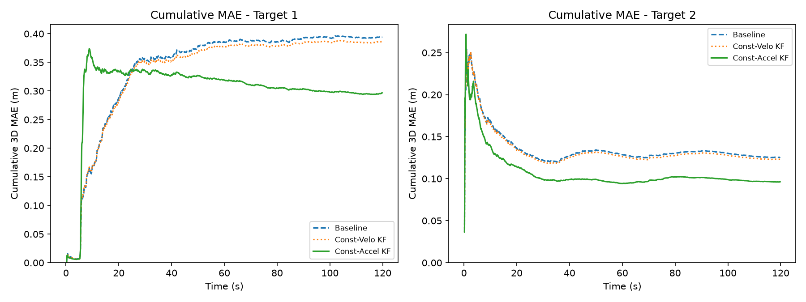

# Evaluation results

Mean Euclidean position error in 3D (**3D MAE**), measured in metres. Lower values indicate better accuracy. KF stands for Kalman filter.

| Estimator | Sample 1 (3D MAE in m) | Sample 2 (3D MAE in m) |
| :--- | ---: | ---: |
| Baseline | 0.395 | 0.126 |
| Constant velocity KF | 0.387 | 0.123 |
| Constant acceleration KF | **0.297** | **0.096** |



## How to run

Evaluate one estimator on one supplied target scenario:

Python:

```bash
python3 tools/evaluate.py \
  --estimator python/global_estimator \
  --scenario data/target1_xyz.csv
```

A successful run prints one line and creates no prediction file:

```text
MAE: <value> m
```

Use either `data/target1_xyz.csv` or `data/target2_xyz.csv` as the scenario. Estimator process output is captured in memory, and failures are written to standard error.
